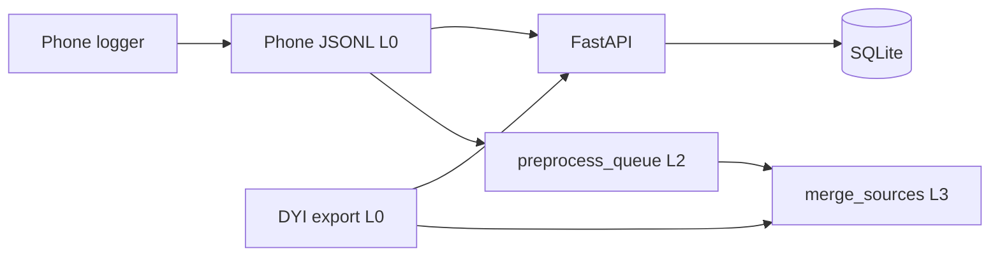
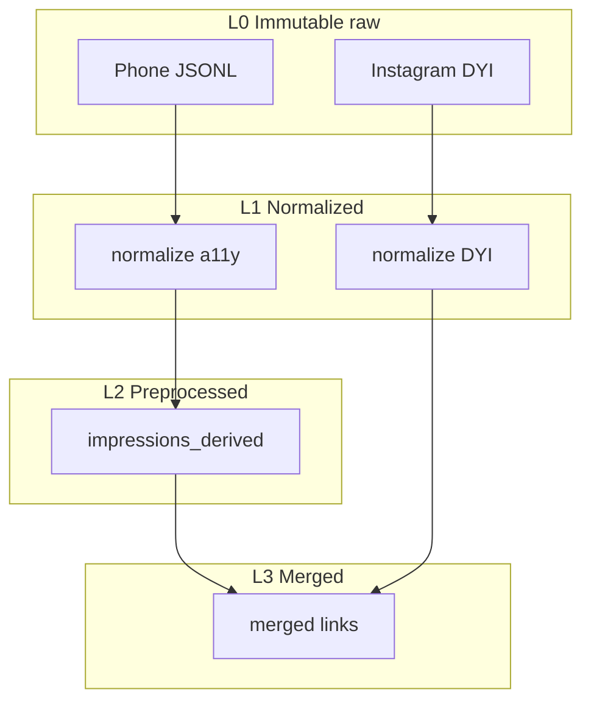

# Architecture

## Processes



| Process | Role |
| --- | --- |
| Phone logger | Capture timing events + optional tree samples; local JSONL (immutable once pulled) |
| FastAPI on PC | Ingest, sessionize, import, report (live path) |
| `preprocess_queue.py` | Offline L2 derived impressions from any JSONL era |
| `merge_sources.py` | Offline L3 links between derived impressions and DYI |
| Postgres / Supabase | Same models via `DATABASE_URL` (seam) |

Heavy stats stay in notebooks. Derived CSVs live under `data/derived/` (gitignored) and never overwrite L0 files.

## Layered sources (L0–L3)



| Layer | What | Mutate L0? |
| --- | --- | --- |
| **L0** | Phone JSONL pull; DYI zip/JSON as downloaded | Never |
| **L1** | Normalized rows in memory / importers | No — views of L0 |
| **L2** | `data/derived/<run_id>/impressions.csv` + manifest | No — new files only |
| **L3** | `data/derived/<run_id>/merged.csv` | No — new files only |

### L2 `impressions.csv` columns

| Column | Meaning |
| --- | --- |
| `impression_id` | Stable id for this derived row |
| `shown_at` / `hidden_at` | UTC ISO from semantic events |
| `dwell_ms` | From shown→hidden only (never from DYI) |
| `creator_handle` / `caption_excerpt` | PC identity (or weak on-device hint) |
| `identity_confidence` / `identity_method` | How identity was chosen (`raw_reel_by`, `raw_profile_picture`, `on_device_hint`, …) |
| `quality_flags` | Semicolon-separated audit flags |
| `source_jsonl` / `logger_version` / `schema_era` / `preprocess_version` | Provenance |
| `kept` / `dropped_reason` | Filter outcome (`min_dwell`, chrome, share-sheet, …) |

Also written: `preprocess_manifest.json` (counts, flags, input path).

### L3 `merged.csv` columns

| Column | Meaning |
| --- | --- |
| `match_status` | `matched` / `ambiguous` / `logger_only` / `dyi_only` |
| `match_method` | e.g. `time_window`, `time_window+caption` |
| `match_dt_s` | Seconds between logger shown and DYI watched (empty if unmatched) |
| Logger fields | `impression_id`, `shown_at`, `hidden_at`, `dwell_ms`, identity + quality |
| DYI fields | `watched_at`, `external_url`, `dyi_caption`, `fbid` |
| `source_jsonl` / `source_export_path` / `merge_version` | Provenance |

**API reconcile** still uses DB statuses `unique` / `ambiguous` / `unmatched`. Offline L3 uses the four `match_status` values above so plots can show DYI-only and logger-only rows.

### Visualization

| Script | Input | Notes |
| --- | --- | --- |
| `scripts/visualize_merged.py` | L3 `merged.csv` | Preferred analysis figure; `--hide-dyi-only`, `--matched-only` |
| `scripts/visualize_queue.py` | L0 JSONL | Capture QA / debug |

Both plot **absolute clock** x-ticks via `--tz` (default `Europe/Copenhagen`; pass `UTC` for UTC).

### JSONL eras (backwards compatible)

| Era | Markers | Identity on PC |
| --- | --- | --- |
| A | No `raw_a11y` | Weak on-device hints only |
| B | `raw_a11y` + `texts_sample` | Phrase extractors (`Reel by X`, …) |
| C | `raw_a11y` + `nodes[]` bounds + `texts_sample` | Spatial + phrase |

### Explicit stages (CLI)

```powershell
# L2 — raw JSONL untouched
python scripts\preprocess_queue.py data\phone-queue\events-….jsonl

# L3 — join derived + DYI
python scripts\merge_sources.py data\derived\<run_id>\impressions.csv `
  --export-root "C:\path\to\instagram-export"
```

Each command prints a `[preprocess]` / `[merge]` banner with inputs, outputs, and counts.

## Semantic wire format

Clients may attach OS detail **inside** `raw_a11y` payloads for offline analysis. The server sessionizer only uses semantic types: `session_start`, `session_end`, `reel_shown`, `reel_hidden`, `interaction`. Unknown types (including `raw_a11y`) are stored if ingested and ignored by `sessionize`.

A batch is:

- `schema_version`, `device_id`, `user_id`, `platform`, `capture_method`
- `events[]` with `type`, `observed_at`, `payload`, optional `event_id`

On-device creator/caption guesses are **hints** (`identity_source=on_device_heuristic_v1` or under `payload.hints`). When era B/C raw exists, PC identity wins.

See [event-schema.md](event-schema.md).

## Service boundaries

| Module | Responsibility |
| --- | --- |
| `app/api/*` | Thin routers |
| `app/services/ingest.py` | Validate and append raw events |
| `app/services/sessionize.py` | Semantic events → sessions + impressions |
| `app/services/reconcile.py` | Match impressions to content records (API path) |
| `app/services/importers/dyi.py` | Shape-tolerant DYI reader (shared with offline merge) |
| `app/services/derived/preprocess.py` | L2 logic (shared by CLI) |
| `app/services/derived/merge.py` | L3 logic (shared by CLI) |
| `scripts/preprocess_queue.py` | Offline L2 CLI |
| `scripts/merge_sources.py` | Offline L3 CLI |
| `scripts/compare_logger_dyi.py` | Thin alias: preprocess → merge |
| `scripts/visualize_merged.py` | L3 timeline |
| `scripts/visualize_queue.py` | L0 timeline (debug) |

## Data flow (API path)

1. Phone posts a batch to `POST /ingest/events` (or JSONL is ingested via script).
2. `ingest` stores every event in `raw_events`.
3. `sessionize` rebuilds `sessions` / `impressions` from semantic types only.
4. DYI import → `content_records`.
5. `reconcile` → `impression_matches` (`unique` / `ambiguous`).
6. Offline preprocess/merge can run **without** the API for research iteration.

## Config

- `DATABASE_URL` — SQLite by default
- User timezone (default `Europe/Copenhagen`)
- Session gap (default 60 seconds)
- `API_TOKEN` — required when binding beyond localhost

## Android client

Kotlin module, Instagram package only, logging notification. Capture-max: timing events always; structured `raw_a11y` when debug is on (era C from `0.1.1-android`). See [android-detector.md](android-detector.md), [deploy.md](deploy.md).
