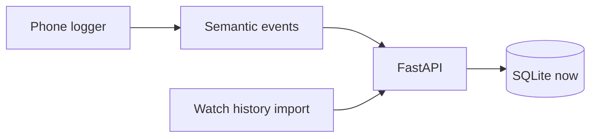

# Architecture

## Processes

| Process | Role | Status |
| --- | --- | --- |
| Phone logger | Translate OS UI into semantic events; local JSONL queue | Android next; iOS later (weaker) |
| FastAPI on PC | Ingest, sessionize, import, report | This slice |
| DYI import | Catalog rows from Instagram’s data download | Contract + stub |
| Postgres / Supabase | Same models via `DATABASE_URL` | Seam only |

Heavy stats stay in notebooks. The API returns rows and small session/day aggregates.

## Semantic wire format

Clients translate their own OS **before** anything is stored. The server never requires package names, view ids, or accessibility class names.

A batch is:

- `schema_version`, `device_id`, `user_id`, `platform`, `capture_method`
- `events[]` with `type`, `observed_at`, semantic `payload`

Event types `sessionize` understands: `session_start`, `session_end`, `reel_shown`, `reel_hidden`, `interaction`. Unknown types are stored in `raw_events` and ignored by the sessionizer. Debug dumps (`raw_a11y`) are off by default.

See [event-schema.md](event-schema.md).

## Service boundaries

| Module | Responsibility |
| --- | --- |
| `app/api/*` | Thin routers; no business logic |
| `app/services/ingest.py` | Validate and append raw events |
| `app/services/sessionize.py` | Pure function: semantic events → sessions + impressions |
| `app/services/reconcile.py` | Match impressions to content records |
| `app/services/platforms/*` | Social-app meaning (surfaces, interaction names). Not OS detection |
| `app/services/importers/dyi.py` | Shape-tolerant Instagram export reader |
| `app/services/reporting.py` | Session list and per-day counts |

Platform codes (`instagram`, `tiktok`, `youtube_shorts`) are orthogonal to OS (`devices.platform_os`). TikTok and YouTube Shorts adapters exist as stubs that raise until implemented.

## Data flow

1. Phone (or import) posts a batch to `POST /ingest/events`.
2. `ingest` stores every event in `raw_events`.
3. `sessionize` rebuilds `sessions` and `impressions` from semantic types only. A session may have zero impressions.
4. DYI / manual URLs land in `content_records`.
5. `reconcile` writes `impression_matches` with `unique` or `ambiguous`.
6. `reporting` exposes session and day views for notebooks and later wireless sync.

## Config

- `DATABASE_URL` — SQLite by default; Postgres/Supabase later
- User timezone (default `Europe/Copenhagen`) for day bucketing
- Session gap (default 60 seconds)
- API token placeholder — unused while bound to localhost

## Android client (next milestone)

Kotlin, one module, Instagram package only, visible “logging on” notification. Aggressive filtering of accessibility events (ignore progress ticks). Install path in [deploy.md](deploy.md).

## Later wireless probe

Phone POSTs batches to the PC on the LAN. Same semantic contract. Default bind remains localhost until that step.
